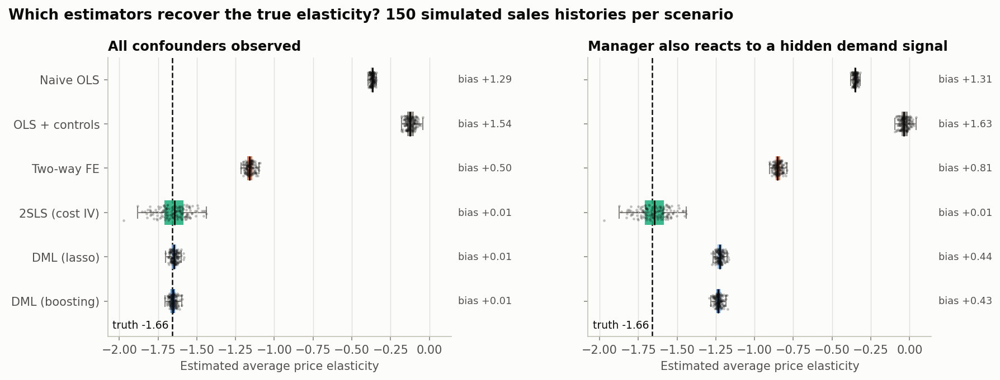
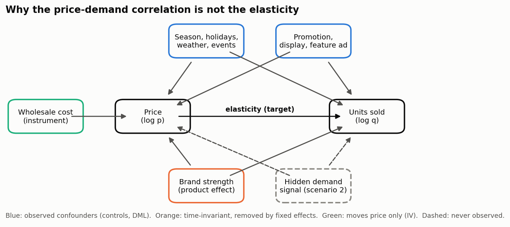
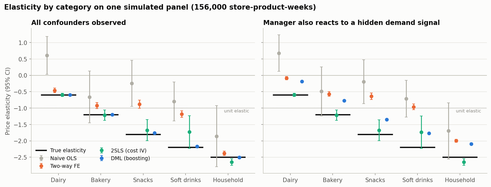
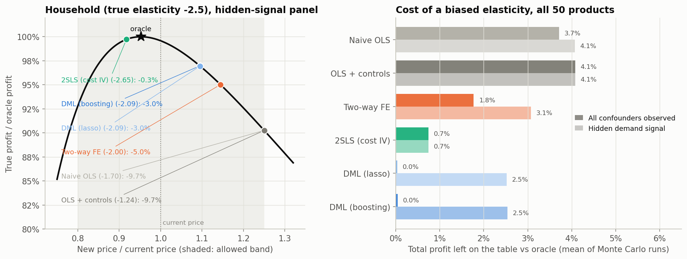

# Price Elasticity with Causal ML

Estimating price elasticity from sales data is a causal problem. On a retail simulator with
known ground truth, this repo shows why naive regression gets it wrong, how fixed effects,
instrumental variables and Double Machine Learning fix it (and when they don't), and how much
profit a biased estimate costs when you use it to set prices.

[](https://github.com/faiqrasulov/price-elasticity-causal-ml/actions/workflows/ci.yml)

[](LICENSE)

## Key results

All data are **simulated**: true elasticities are unknowable in real sales data, so a simulator
is the only way to measure an estimator's bias. True average elasticity **-1.66** (five
categories from -0.6 to -2.5). Monte Carlo: 150 simulated sales histories per scenario;
every number is in [`reports/metrics.json`](reports/metrics.json) and is reproduced by `make run`.

| Estimator | Average elasticity, all confounders observed | Average elasticity, hidden demand signal | Category-level RMSE (observed / hidden) | Profit left on the table (observed / hidden) |
|---|---:|---:|---:|---:|
| Naive OLS | -0.37 | -0.35 | 1.12 / 1.21 | 3.71% / 4.07% |
| OLS + controls | -0.12 | -0.03 | 1.44 / 1.54 | 4.08% / 4.08% |
| Two-way fixed effects | -1.16 | -0.85 | 0.60 / 0.86 | 1.77% / 3.07% |
| 2SLS, wholesale cost as instrument | **-1.65** | **-1.65** | 0.22 / 0.22 | 0.74% / 0.74% |
| Double ML, lasso | **-1.65** | -1.22 | **0.04** / 0.44 | **0.03%** / 2.52% |
| Double ML, gradient boosting | **-1.65** | -1.23 | 0.05 / 0.43 | 0.04% / 2.54% |

Means over the Monte Carlo runs. "Profit left on the table" is the true profit lost when all 50
prices are set from the estimator's category elasticities, relative to an oracle that knows
them (same price guardrails).

- **Naive regression is badly wrong.** Pooled OLS of log units on log price gives -0.37
  instead of -1.66, and adding observed controls makes it *worse* (-0.12): premium brands
  are both pricier and better-selling, so cross-product price differences masquerade as
  inelastic demand. Dairy even comes out with a positive elasticity.
- **Fixed effects are not enough.** Two-way fixed effects remove brand and store effects but
  not the category-specific demand peaks the pricing manager reacts to: -1.16 even when
  every confounder is in the data.
- **Double ML recovers the truth when the confounders are observed** (-1.65, category
  RMSE 0.04-0.05), **but not when the manager also uses a demand signal the analyst
  cannot see** (-1.23). DML adjusts for what you observe, nothing more.
- **The cost instrument works in both scenarios** (-1.65, first-stage F ~ 1,300), at
  the price of about 5x the category-level RMSE of DML.
- **Bias costs money.** Pricing every product from these estimates, a naive model leaves
  3.7-4.1% of the attainable profit on the table, two-way FE 1.8-3.1%, IV
  0.74% and DML 0.03-0.04% (or 2.5% with a hidden demand signal).



## Problem & why it matters

Retailers and marketplace sellers set thousands of prices, and the price-optimisation tools
behind them all start from an elasticity estimate: how much do units fall when price rises
1%? The data those estimates come from are observational, and prices were not set at random.
Category managers raise prices when they expect demand to be strong (Christmas for snacks,
heat waves for soft drinks, a local event near a store), cut them with promotions that also
come with displays and flyers, and price strong brands higher. So in the raw data, high prices
coincide with high demand, and a regression of sales on price mixes the demand curve with the
pricing policy. The result is an elasticity that is biased towards zero, sometimes with the
wrong sign, and price recommendations that are systematically too high.

This project makes the problem concrete and measurable: it simulates a retailer where the true
elasticities are known, runs the standard estimators on the simulated sales history, and
scores both the estimates and the prices they lead to.



## Approach

**Simulator** (`simulate.py`). 20 stores x 50 products (5 categories x 10) x 156 weeks
= 156,000 store-product-weeks. Log-log demand with a product (brand) effect, store traffic,
category-specific seasonality, holidays, heat (nonlinear, above 20 C), local events, and
promotions with in-store displays and feature ads. The pricing rule:

- raises price with the demand the manager can anticipate from season, holidays, weather and
  events (all in the data),
- cuts price by 20% in promotion weeks (which also carry display and feature-ad lifts),
- passes through 80% of a wholesale-cost shock (moves price, not demand: a valid instrument),
- in the **hidden-signal scenario** also reacts to a store-product demand signal that never
  appears in the data (an AR(1) shock, e.g. local intel about a competitor's stock-out).

The two scenarios use the same random draws (common random numbers) and differ only in that
last line. True elasticities are -0.6 (Dairy), -1.2 (Bakery), -1.8 (Snacks), -2.2 (Soft
drinks) and -2.5 (Household); the pooled target is their average, -1.66.

**Estimators** (`estimators.py`, `linear.py`, `dml.py`). Each returns an average elasticity
and one per category (log price interacted with category). All standard errors are clustered
by product, because cost shocks, promotions and feature ads are set chain-wide per product
and week.

| Estimator | What it adjusts for | Implementation notes |
|---|---|---|
| Naive OLS | nothing | `log q ~ log p` |
| OLS + controls | observed covariates, linearly | promotions, display, feature, holiday, event, temperature, traffic, Fourier season, category |
| Two-way FE | store x product and week effects + time-varying controls | within transformation by alternating projections (exact on unbalanced panels too), CR1 errors with the absorbed week effects counted |
| 2SLS (cost IV) | anything independent of the cost shock | same fixed effects and controls; cluster-robust first-stage F reported |
| DML (lasso) | observed confounders, flexibly | partially linear model; lasso on category x (Fourier, holiday, event, temperature splines) + promotion flags; penalty chosen by BIC |
| DML (boosting) | observed confounders, flexibly | same, with `HistGradientBoostingRegressor` on the raw confounders (store and category as categorical) |

The **Double ML** estimator (Chernozhukov et al. 2018) is written from scratch on top of
scikit-learn learners: cross-fitted nuisances `E[log q | X]` and `E[log p | X]`, then the
Neyman-orthogonal residual-on-residual estimate with a cluster-robust sandwich variance.
Two design decisions mattered, both found in pilot runs:

1. **Remove the store x product effects first, then learn the rest.** Trees are poor at
   learning a thousand additive unit effects and a lasso shrinks them; either way the leftover
   brand effect sits in both residuals and biases the estimate. Within-transforming log q and
   log p by store x product (as in Clarke & Polselli's panel DML) leaves the learners only the
   time-varying confounding.
2. **Cross-fit by whole products, the cluster level.** With folds of store x product units,
   the other stores of the same product sit in the training folds and share its wholesale-cost
   shocks, so information leaks across folds and the standard errors come out too small.
   Product-level folds remove the leak (cf. Chiang et al. 2022 on cluster-robust DML).

**Pricing** (`pricing.py`). With constant elasticity and unit cost c, profit is maximised at
the Lerner price p* = c * eps / (1 + eps) when eps < -1. When |eps| <= 1 there is no interior
optimum (profit keeps rising with price), so prices are chosen inside a guardrail band of
-20% to +25% of the current price, and such estimates are flagged; their constrained optimum is
the top of the band. Each estimator's category elasticities set the 50 prices; the resulting
**true** profit is compared with an oracle that knows every elasticity and faces the same band.

**Evaluation** (`pipeline.py`). (1) One large panel per scenario for point estimates and CIs.
(2) A Monte Carlo of 150 re-simulated histories per scenario on a smaller panel
(4 stores x 50 products x 104 weeks) for bias, RMSE, 95% CI coverage and profit
loss. Replications run in 4 worker processes; each is seeded on its own, so results do not
depend on scheduling.

**Correctness checks** (30 tests, ~10 s): the within transformation equals OLS
with dummies (statsmodels, unbalanced panel), CR1/HC1 errors match statsmodels, 2SLS equals a
manual two-stage fit and the matrix closed form, the first-stage F equals the squared robust
t-statistic, DML recovers a known effect in a partially linear model while misspecified
nuisances do not, the DML standard error equals a clustered residual regression, the Lerner
price matches numeric optimisation and a grid search within the band, the simulator yields the
true elasticity when pricing is unconfounded, and the pipeline runs end to end on a tiny panel.

## Results

### (a) Monte Carlo: bias, RMSE, coverage

150 re-simulated histories per scenario, 4 stores x 50 products x 104 weeks (20,800 rows each).
Category columns pool the five category elasticities; coverage is the share of nominal 95%
CIs that contain the true category elasticity (in brackets: with t(9) critical values, since
each category rests on 10 product clusters).

**All confounders observed**

| Estimator | Average: mean | Bias | SD | RMSE | Category: mean abs. bias | RMSE | 95% CI coverage | Profit left: mean | 90th pct. |
|---|---:|---:|---:|---:|---:|---:|---:|---:|---:|
| Naive OLS | -0.369 | +1.291 | 0.012 | 1.291 | 1.050 | 1.124 | 40.0% (40.0%) | 3.71% | 4.08% |
| OLS + controls | -0.122 | +1.538 | 0.028 | 1.538 | 1.405 | 1.439 | 2.8% (17.1%) | 4.08% | 4.08% |
| Two-way FE | -1.158 | +0.502 | 0.025 | 0.503 | 0.483 | 0.604 | 4.4% (8.3%) | 1.77% | 1.83% |
| 2SLS (cost IV) | -1.650 | +0.010 | 0.094 | 0.094 | 0.016 | 0.220 | 92.8% (96.0%) | 0.74% | 1.52% |
| DML (lasso) | -1.646 | +0.014 | 0.021 | 0.025 | 0.016 | 0.044 | 90.7% (93.9%) | 0.03% | 0.07% |
| DML (boosting) | -1.653 | +0.007 | 0.021 | 0.022 | 0.013 | 0.045 | 89.3% (92.0%) | 0.04% | 0.08% |

**Manager also reacts to a hidden demand signal**

| Estimator | Average: mean | Bias | SD | RMSE | Category: mean abs. bias | RMSE | 95% CI coverage | Profit left: mean | 90th pct. |
|---|---:|---:|---:|---:|---:|---:|---:|---:|---:|
| Naive OLS | -0.351 | +1.309 | 0.012 | 1.309 | 1.157 | 1.212 | 28.7% (38.7%) | 4.07% | 4.08% |
| OLS + controls | -0.033 | +1.627 | 0.027 | 1.627 | 1.514 | 1.540 | 0.0% (0.3%) | 4.08% | 4.08% |
| Two-way FE | -0.849 | +0.811 | 0.023 | 0.811 | 0.804 | 0.858 | 0.0% (0.0%) | 3.07% | 3.34% |
| 2SLS (cost IV) | -1.650 | +0.010 | 0.095 | 0.095 | 0.016 | 0.220 | 92.5% (95.9%) | 0.74% | 1.53% |
| DML (lasso) | -1.224 | +0.435 | 0.021 | 0.436 | 0.437 | 0.439 | 0.0% (0.0%) | 2.52% | 2.74% |
| DML (boosting) | -1.234 | +0.426 | 0.021 | 0.427 | 0.429 | 0.431 | 0.0% (0.0%) | 2.54% | 2.79% |

The 2SLS first stage is strong in every run (median cluster-robust F 1,339, minimum 637).

Interpretation:

- **Naive and flat OLS are not estimates of the demand curve.** Most of their price variation
  is between products, and in this market premium brands are both pricier and better-selling.
  Adding controls removes the between-category variation but keeps the within-category brand
  confounding, so the estimate moves *towards* zero (-0.12) and four of five categories come
  out with |eps| <= 1. Their category CIs are so wide (+-0.6 to +-0.9) that they sometimes
  cover the truth, but they are centred on the wrong value.
- **Two-way FE fixes the brand problem but not the pricing policy.** Week effects absorb the
  demand cycle common to all categories, not the category-specific peaks the manager prices
  into. The bias is +0.14 in Dairy and Household (flat seasonality) and +0.91 to +0.93 in
  Snacks and Soft drinks (Christmas and summer peaks, heat waves).
- **DML works exactly when its assumption holds.** With every confounder observed its bias is
  0.01 and its category RMSE 0.044-0.045, five times smaller than IV's. With the hidden signal
  it is biased by about +0.43 in every category: cross-fitting and orthogonal scores remove
  regularisation bias, not omitted-variable bias.
- **IV is the only estimator that is right in both scenarios** (bias +0.010), because the cost
  shock is independent of every demand driver, observed or not. It pays in variance: its SD is
  4.5x DML's for the average and its category RMSE is 0.22, worst in Snacks and Soft drinks
  where the strong seasonality left in the residual adds noise.
- **Coverage is slightly below 95%** for IV (92.8%) and DML (89.3-90.7%). Each category
  coefficient rests on 10 product clusters, and CR1 standard errors are known to be too small
  with few clusters; t(9) critical values bring IV to 96.0% and DML to 92.0-93.9%. The rest of
  the DML gap is a small bias in Soft drinks (+0.025 lasso, +0.030 boosting; 85-87% coverage),
  the category with the strongest nonlinear confounding (heat above 20 C).
- The **average-elasticity** CIs of IV and DML cover the truth 99-100% of the time: a single
  slope's clustered SE also absorbs the spread of true elasticities across categories (-0.6 to
  -2.5), so it is conservative for this fixed assortment. The category-level coverage above is
  the meaningful check.

### (b) Elasticity by category on one large panel



One panel of 20 stores x 50 products x 156 weeks (156,000 rows) per scenario; estimate +- 95% CI
half-width.

| All confounders observed | Average | Dairy (-0.6) | Bakery (-1.2) | Snacks (-1.8) | Soft drinks (-2.2) | Household (-2.5) |
|---|---:|---:|---:|---:|---:|---:|
| Naive OLS | -0.36 | 0.61 +- 0.58 | -0.66 +- 0.79 | -0.24 +- 0.70 | -0.80 +- 0.60 | -1.86 +- 0.93 |
| OLS + controls | -0.12 | 0.85 +- 0.58 | -0.25 +- 0.86 | -0.13 +- 0.72 | -0.44 +- 0.58 | -1.40 +- 0.93 |
| Two-way FE | -1.14 | -0.46 +- 0.07 | -0.93 +- 0.09 | -0.88 +- 0.12 | -1.18 +- 0.10 | -2.38 +- 0.06 |
| 2SLS (cost IV) | -1.57 | -0.60 +- 0.05 | -1.22 +- 0.16 | -1.67 +- 0.32 | -1.73 +- 0.49 | -2.65 +- 0.10 |
| DML (lasso) | -1.66 | -0.59 +- 0.03 | -1.19 +- 0.03 | -1.78 +- 0.02 | -2.21 +- 0.03 | -2.51 +- 0.04 |
| DML (boosting) | -1.65 | -0.59 +- 0.02 | -1.20 +- 0.03 | -1.76 +- 0.02 | -2.17 +- 0.03 | -2.51 +- 0.03 |

| Hidden demand signal | Average | Dairy (-0.6) | Bakery (-1.2) | Snacks (-1.8) | Soft drinks (-2.2) | Household (-2.5) |
|---|---:|---:|---:|---:|---:|---:|
| Naive OLS | -0.34 | 0.68 +- 0.56 | -0.49 +- 0.75 | -0.20 +- 0.67 | -0.71 +- 0.56 | -1.70 +- 0.86 |
| OLS + controls | -0.03 | 0.93 +- 0.56 | -0.08 +- 0.82 | -0.07 +- 0.68 | -0.34 +- 0.54 | -1.24 +- 0.86 |
| Two-way FE | -0.84 | -0.09 +- 0.05 | -0.57 +- 0.07 | -0.64 +- 0.10 | -0.96 +- 0.09 | -2.00 +- 0.05 |
| 2SLS (cost IV) | -1.57 | -0.60 +- 0.05 | -1.22 +- 0.16 | -1.68 +- 0.32 | -1.74 +- 0.49 | -2.65 +- 0.10 |
| DML (lasso) | -1.24 | -0.18 +- 0.03 | -0.77 +- 0.02 | -1.35 +- 0.01 | -1.79 +- 0.03 | -2.09 +- 0.03 |
| DML (boosting) | -1.23 | -0.19 +- 0.02 | -0.77 +- 0.02 | -1.35 +- 0.02 | -1.77 +- 0.02 | -2.09 +- 0.03 |

With every confounder observed, both DML variants land within 0.04 of all five true
elasticities, with CIs of +-0.02 to +-0.04 (the boosting CI for Soft drinks, -2.17 +- 0.03,
just misses -2.2, in line with the small Soft-drinks bias above). IV is centred correctly but
its Snacks and Soft-drinks intervals are +-0.32 and +-0.49, too wide to price from on their
own. With the hidden signal, DML and two-way FE are *confidently wrong*: they have the
narrowest intervals in the table and none of them contains the truth (DML puts Dairy at -0.19
against a true -0.6). Precision is not accuracy.

### (c) What the bias costs when you set prices



The oracle (true elasticities, -20%/+25% guardrails) raises Dairy and Bakery to the top of
the band, raises Soft drinks by 11% and cuts Snacks by 6% and Household by 5%. Keeping
current prices leaves 10.5% of the attainable profit on the table, almost all of it in Dairy
and Bakery, where the model optimum is the top of the band. Every estimator beats that, even
naive OLS, because even a badly biased estimate calls those two categories inelastic.

The damage from bias is concentrated in the elastic categories. An elasticity biased towards
zero says "customers barely react", so the recommended price is too high (left panel: in the
hidden-signal panel, naive OLS and flat OLS put Household at the +25% cap and lose 9.7% of its
profit; two-way FE loses 5.0%, DML 3.0%, IV 0.3%). Across the Monte Carlo runs, naive and flat
OLS leave 3.7-4.1% of total profit on the table, mostly from Snacks (4.7% of the category's
profit) and Household (8-10%); two-way FE 1.8% / 3.1%; DML 0.03-0.04% when all confounders are
observed but 2.5% with the hidden signal; IV 0.74% in both, with a 90th percentile of 1.5%. IV
loses money through noise, the biased estimators through bias.

Estimates with |eps| <= 1 have no profit-maximising price and are flagged: naive and flat OLS
flag 4 of 5 categories in every run, two-way FE about 3, DML with the hidden signal 2, while
IV and DML with all confounders observed flag essentially only Dairy (1.00-1.03 categories
per run; Dairy's true elasticity is -0.6). The
guardrail band is what keeps those flagged categories from an unbounded price increase.

### What did not work, or only partly

- **DML on raw identifiers.** Pilot runs that gave the boosting learner store and product
  ids as categorical features, instead of removing the store x product effects first, were
  clearly biased in the categories with the strongest confounding; the lasso version shrank
  the product dummies and was biased too. The within transformation fixed both.
- **Cross-fitting by store x product unit.** Fold assignment at the unit level gave standard
  errors that were too small (Monte Carlo spread well above the reported SEs), because the
  other stores of the same product share its cost shocks across folds. Product-level folds
  fixed it.
- **A small residual bias in boosting-DML.** Even after moving to 100 trees with 31 leaves, the
  Soft-drinks estimate keeps a +0.03 bias (85% coverage). More trees reduce it further but
  cost run time; the lasso, whose basis includes category-specific temperature splines,
  does slightly better there.
- **IV is not precise enough per category.** With only the cost shock as variation and
  seasonal noise left in the residual, the Soft-drinks CI is +-0.49 on 156,000 rows.
  Richer controls (or DML-IV, below) would tighten it.
- **Controls without fixed effects backfire.** Flat OLS with every observed control is worse
  than the naive regression in both scenarios.

## Which estimator should I use?

1. **Never price from a naive or flat regression on observational data.** Both were off by
   +1.3 to +1.6 and called four of five categories inelastic.
2. **Treat two-way fixed effects as the floor, not the answer.** They remove brand and store
   effects but stay biased (+0.5 here) whenever prices react to category-specific demand.
3. **If every demand signal the pricing team uses is in your data** (promo calendar, demand
   forecast inputs, events, weather), **use Double ML**: remove the unit fixed effects first,
   use flexible learners for the nuisances and cross-fit at the cluster level. It was the most
   precise unbiased estimator here (category RMSE 0.04-0.05, 0.03-0.04% profit loss).
4. **If prices may also react to things you cannot see, you need an instrument.** A cost-side
   shifter (supplier cost changes, commodity or exchange-rate moves, tax changes) that moves
   price but not demand gave unbiased estimates in both scenarios. Check the first stage
   (F in the hundreds here; below about 10 the estimate is unreliable) and expect wide CIs.
5. **Run both and compare.** DML and IV agree when the observed controls are sufficient
   (-1.65 and -1.65 in the Monte Carlo) and disagree when they are not (-1.23 vs -1.65; on the
   large panel -1.23 vs -1.57). A gap like that is evidence of unobserved confounding.
6. **Check |eps| > 1 before optimising.** An estimate with |eps| <= 1 has no profit-maximising
   price; treat it as a diagnostic for confounding, not as an instruction to go to the top of
   the band.

## Quickstart

```bash
git clone https://github.com/faiqrasulov/price-elasticity-causal-ml.git
cd price-elasticity-causal-ml
make install          # pip install -e ".[dev]"
make run              # main analysis + Monte Carlo -> reports/metrics.json + figures (about 4 minutes on an 8-core laptop)
make test             # 30 tests, ~10 s
make data             # optional: write the simulated panel to data/simulated_panel.csv.gz
```

```python
from elasticity import SimConfig, make_design, simulate_panel, ESTIMATORS

cfg = SimConfig(hidden_confounding=0.0)            # all confounders observed
design = make_design(cfg, seed=7)
df = simulate_panel(design, cfg, seed=1).data      # store x product x week panel
label, estimator = ESTIMATORS["dml_boosting"]
est = estimator(df, n_cat=5)
est.pooled, est.by_category, design.category_elasticity
```

## Project structure

```
src/elasticity/
  simulate.py      market design + weekly panel with a confounded pricing rule
  linear.py        OLS / 2SLS with cluster-robust errors, within transformation
  dml.py           cross-fitted partially linear Double ML
  estimators.py    the six estimators (average + per-category elasticities)
  pricing.py       Lerner prices in a guardrail band, profit vs oracle
  pipeline.py      main analysis + Monte Carlo -> reports/metrics.json
  figures.py       report figures
  cli.py           `elasticity run` / `elasticity simulate`
reports/           metrics.json and figures written by `make run`
tests/             pytest suite (references: statsmodels, scipy, closed forms)
```

## Limitations & next steps

- **It is a simulation.** The results describe how the estimators behave under the simulator's
  assumptions: constant-elasticity log-log demand, no cross-price effects (no substitution or
  promotion cannibalisation), no stock-outs or zero sales, no dynamics (stock-piling, reference
  prices). Real scanner data break all of these.
- **The confounding is designed, and its size drives the headline numbers.** DML's +0.43 bias
  scales with how strongly the hidden signal moves prices; a weaker signal would give a smaller
  bias. The instrument is valid by construction; in real data its exclusion restriction (cost
  shocks unrelated to demand, e.g. commodity prices that move with weather) has to be argued.
- **Inference with few clusters.** Category estimates rest on 10 product clusters each, and
  CR1 standard errors under-cover slightly (above). The average-elasticity SEs are conservative.
- **The profit model is single-product.** Prices are set product by product within a guardrail
  band; it ignores store-traffic effects of staples (retailers often keep milk and bread cheap on
  purpose, which this model would undo by raising them to the band's top) and competitor
  responses.
- **Light tuning.** One set of boosting hyperparameters, a BIC-chosen lasso penalty and a single
  cross-fitting split (no repeated splits); a per-category nuisance model or more trees would
  likely remove the remaining Soft-drinks bias.
- **Next steps:** partially linear IV with DML (flexible controls plus the cost instrument),
  product-level heterogeneity (DML with product interactions or a causal forest), cross-price
  elasticities, and a real scanner-data case study (e.g. Dominick's Finer Foods) where the
  estimators are compared without ground truth.

## Data & references

No external data are used. Everything is simulated with fixed seeds (`src/elasticity/simulate.py`,
`src/elasticity/pipeline.py`), because measuring an estimator's bias requires the true
elasticity, which no real dataset provides. The simulated numbers say how the methods behave
under the stated assumptions, not what elasticities real products have.

- Chernozhukov, Chetverikov, Demirer, Duflo, Hansen, Newey & Robins (2018). *Double/debiased
  machine learning for treatment and structural parameters.* The Econometrics Journal 21(1).
- Clarke & Polselli (2023). *Double machine learning for static panel models with fixed
  effects.* arXiv:2312.08174.
- Chiang, Kato, Ma & Sasaki (2022). *Multiway cluster robust double/debiased machine
  learning.* Journal of Business & Economic Statistics 40(3).
- Bach, Chernozhukov, Kurz & Spindler (2022). *DoubleML: an object-oriented implementation of
  double machine learning in Python.* Journal of Machine Learning Research 23.
- Berry, Levinsohn & Pakes (1995). *Automobile prices in market equilibrium.* Econometrica
  63(4). (Price endogeneity and cost-side instruments in demand estimation.)
- Cameron & Miller (2015). *A practitioner's guide to cluster-robust inference.* Journal of
  Human Resources 50(2).
- Gaure (2013). *OLS with multiple high dimensional category variables.* Computational
  Statistics & Data Analysis 66.
- Stock & Yogo (2005). *Testing for weak instruments in linear IV regression.* In
  Identification and Inference for Econometric Models, Cambridge University Press.
- Angrist & Pischke (2009). *Mostly Harmless Econometrics.* Princeton University Press.

## License

MIT, see [LICENSE](LICENSE).
